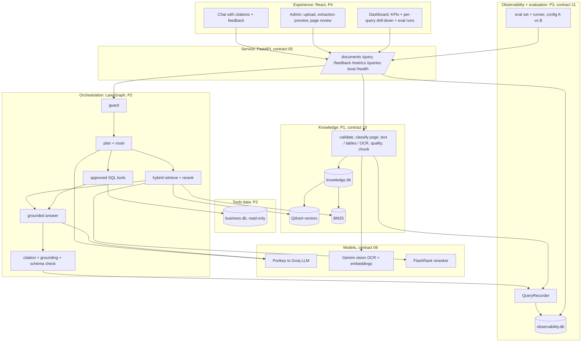

<!-- Contract 00. Owner: D (all agree). Status: DRAFT until the design review, then FROZEN v1.0.
     After freezing, change only through the design-change skill: an entry in CHANGES.md and a version bump. -->
# 00 Brief and scope: Enterprise Knowledge Intelligence Assistant

Version: 1.0 · Status: DRAFT · Owner: D (all agree) · Case section(s): 1, 2, 3, 4, 8, 12

## Goal in one sentence

An employee asks a question and gets a short answer with the exact document page, section or data row that
supports it, or an honest "not enough evidence"; and every query is visible on one dashboard with its quality,
time and cost.

## Starting point

We do not start from zero. The team's `chatbot` repo already has: LangGraph planner, retriever and responder;
Qdrant with Gemini embeddings; FlashRank reranking; Gemini vision OCR for scanned PDFs; a guardrail gate; a
RAGAS eval suite; a React chat and admin page. We add what the case asks and that repo lacks: page-level
extraction (handwriting, tables, mixed PDFs, images), hybrid retrieval, an approved SQL tool, the query event
store, the dashboard, the evaluation set and the configuration experiment.

## Architecture (case section 6 layers; P1 to P4 are the owners in contract 01)

## Success measures (our targets; the case sets none, see assumptions.md)

| Measure | Target | How our system shows it |
|---|---|---|
| Retrieval hit@5 on the eval set (expected document and page in the top 5) | at least 0.80 with config B | `output/eval_comparison.csv`, dashboard Evaluation tab |
| Citation support: citations that map to returned evidence | 100 % (the validator removes the rest) | KPI tile, per-query Citations panel |
| Correct fallback on insufficient-evidence cases | 100 % of those eval cases | eval results, behaviour column |
| Injection cases where the hidden instruction is ignored | 100 % | eval results, Safety events KPI |
| Extraction: numbers found exactly on financial pages | at least 0.98 numeric recall | `output/extraction_quality.csv` |
| Extraction: handwritten note character error rate | reported honestly; aim at most 0.10 | `output/extraction_quality.csv` |
| End-to-end latency, median | under 8 s on the demo machine | KPI tile, per-query Performance panel |
| Cost per query | shown for every query; estimate where the provider gives no usage | KPI tile, per-query Usage panel |

## Scope

| Priority | Item | Owner | In the demo? |
|---|---|---|---|
| MUST | FR-01 intake validation, FR-02 page-level extraction with metadata (contract 10) | extraction owner | yes |
| MUST | FR-03 repeatable indexing, FR-04 hybrid retrieval, FR-05 reranking | retrieval owner | yes |
| MUST | FR-07 routing to documents, SQL tool or both; FR-08 grounded answer with citations; FR-10 safe fallback | agent owner | yes |
| MUST | FR-12 dashboard: aggregate KPIs and per-query drill-down; query event schema; outcome rules (contract 11) | observability owner | yes |
| MUST | Evaluation set (10 scenarios) and config A versus B comparison (case sections 9, 10) | observability owner | yes |
| SHOULD | FR-06 multi-turn follow-up with a limited window | agent owner | yes |
| SHOULD | FR-09 conflicts between document versions surfaced | retrieval owner | yes |
| SHOULD | FR-11 helpful / not-helpful feedback with comment | front end | yes |
| SHOULD | Handwritten notes and phone photos (contract 10) | extraction owner | yes |
| MAY | Two-column layout reading order; text-to-SQL beyond the approved templates; RAGAS judge on every query | any | if time |
| OUT (case 4.2) | Training or fine-tuning a model; enterprise identity and full authorisation; real-time connectors; confidential or personal data; voice; a full computer-vision pipeline | none | no |

## Questions for the client (ask at the design review)

1. Is a synthetic business dataset provided, or do we bring our own? (We bring one; assumptions.md 1.)
2. Which LLM and vision model are approved? (We use the team's Portkey gateway to Groq, and Gemini for embeddings and OCR.)
3. When two versions of a policy disagree, which wins: the newest effective date, or must the user choose?
4. What OCR accuracy is acceptable for handwritten notes, and may low-quality pages be searched before a person approves them?
5. Should cost be in USD, and do you have prices for your model contract?
