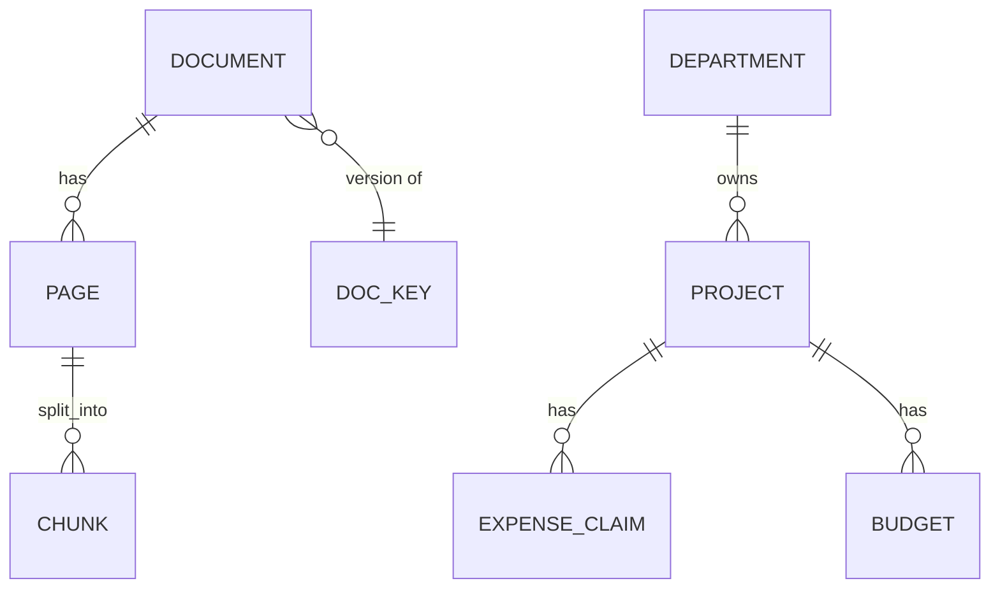

<!-- Contract 02. Owner: P1 (documents), P2 (business data), P3 (events). Status: DRAFT until the design review, then FROZEN v1.0.
     After freezing, change only through the design-change skill: an entry in CHANGES.md and a version bump. -->
# 02 Data model

Version: 1.0 · Status: DRAFT · Owners: P1 knowledge tables, P2 business tables, P3 event tables · Case section(s): 4.1, 6, 12

Three stores, each with one owner:

| Store | Holds | Owner |
|---|---|---|
| SQLite `knowledge.db` + Qdrant collection | documents, pages, chunks (text + vectors); BM25 is rebuilt from `chunk` | P1 |
| SQLite `business.db` | the synthetic business data the SQL tools read (read-only connection) | P2 |
| SQLite `observability.db` | query events, eval runs (contract 11 section 2) | P3 |

Separate files so the SQL tools can open `business.db` read-only and can never touch documents or logs.

## ER diagram (knowledge and business)

## Knowledge tables (P1)

### document

| Column | Type | Null | Notes |
|---|---|---|---|
| document_id | TEXT PK | no | `doc_` + 8 hex of the content hash |
| doc_key | TEXT | no | stable name across versions, for conflict rules (C1) |
| title, category | TEXT | no | from the upload form |
| version | TEXT | no | "1.0", "2.0" |
| effective_date | TEXT (ISO date) | no | for "current version" filter |
| file_name, file_type, size_bytes | | no | |
| content_hash | TEXT UNIQUE | no | duplicate check (X1) |
| status | TEXT CHECK in (QUEUED, EXTRACTING, INDEXED, PARTIAL_REVIEW, FAILED, SUPERSEDED, DELETED) | no | contract 03 |
| page_count, chunk_count | INTEGER | yes | |
| ocr_cost_usd | TEXT (Decimal) | yes | from the ExtractionReport |
| uploaded_by, uploaded_at, indexed_at | | | |

### page

| Column | Type | Null | Notes |
|---|---|---|---|
| document_id, page | TEXT, INTEGER | no | PK together; for DOCX and TXT `page` is the section ordinal |
| printed_page | TEXT | yes | the number printed on the page, if found |
| class | TEXT CHECK in (TEXT, TABLE_HEAVY, MIXED, SCANNED, GARBLED, BLANK) | no | X3 |
| method | TEXT | no | text, text+tables, text_pypdf, ocr, text+ocr, ocr_tesseract |
| quality | REAL | no | X6 |
| flags | TEXT (JSON) | no | HANDWRITTEN, HAS_TABLE, NUMBER_SUSPECT, OCR_FAILED... |
| status | TEXT CHECK in (INDEXED, NEEDS_REVIEW, APPROVED, REJECTED, SKIPPED) | no | X7 |
| text | TEXT | no | full extracted page text, for the preview page |
| reviewed_by, reviewed_at | | yes | |

### chunk

Columns exactly as the chunk record in contract 10 section 9, plus `injection_suspect` (bool, rule S2) and
`pii_found` (bool). Index on `(document_id)`, `(doc_key, version)`, `(searchable)`.

The Qdrant point id is `uuid5(chunk_id)`; its payload copies the chunk record without `text` duplication beyond
`index_text`. SQLite is the source of truth; Qdrant and BM25 can always be rebuilt from it.

## Business tables (P2, synthetic, `business.db`)

A fictional company. No personal data: people appear only as `employee_code` like `E1042`.

| Table | Columns | Why |
|---|---|---|
| department | dept_id PK, name, cost_centre | group spend |
| project | project_id PK (`P-101`), name, dept_id FK, status, start_date | exact-ID questions |
| budget | project_id FK, fiscal_year (`FY2026-27`), category (TRAVEL, SOFTWARE, HARDWARE...), amount NUMERIC(14,2) | "is project X over budget" |
| expense_claim | claim_id PK (`EXP-20871`), project_id FK, employee_code, category, city, amount NUMERIC(14,2), claim_date, status (SUBMITTED, APPROVED, REJECTED, PAID), policy_version | combined questions with the travel policy |

About 8 projects, 3 departments, 300 claims, generated by `scripts/make_business_data.py` with a fixed seed.
Money is `Decimal` in Python and NUMERIC text in SQLite.

## Input files to tables

| Input | Loads into | Idempotency key | Validation |
|---|---|---|---|
| uploaded file | document, page, chunk, Qdrant | `content_hash`; `chunk_id` | contract 10 X1 |
| `scripts/make_business_data.py` | business tables | drop and recreate (seeded) | foreign keys on |
| `evals/eval_set.jsonl` | eval_result rows per run | `(run_id, case_id)` | schema check before a run |
