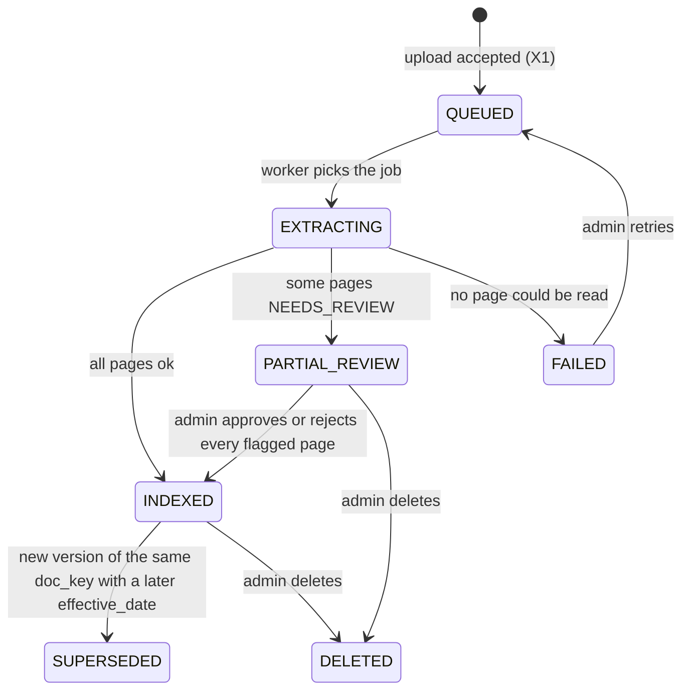
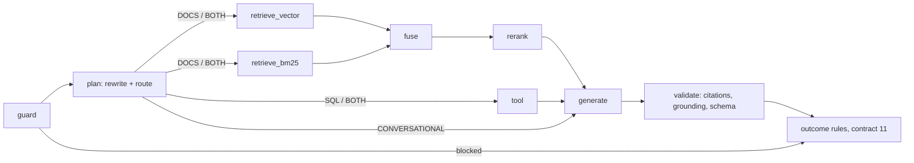

<!-- Contract 03. Owner: P1. Status: DRAFT until the design review, then FROZEN v1.0.
     After freezing, change only through the design-change skill: an entry in CHANGES.md and a version bump. -->
# 03 Lifecycles

Version: 1.0 · Status: DRAFT · Owner: P1 (document, page), P3 (query) · Case section(s): 7

## Document lifecycle

| From | To | Who | Condition | Side effects |
|---|---|---|---|---|
| QUEUED | EXTRACTING | worker | job taken | job status visible on admin page |
| EXTRACTING | INDEXED / PARTIAL_REVIEW / FAILED | worker | page results | ExtractionReport saved; chunks of good pages searchable |
| PARTIAL_REVIEW | INDEXED | KNOWLEDGE_ADMIN | no page left in NEEDS_REVIEW | approved pages become searchable |
| INDEXED | SUPERSEDED | system | a newer version is indexed | chunks stay searchable but `current = false`; conflict rule C1 still sees them |
| any | DELETED | KNOWLEDGE_ADMIN | | chunks and vectors removed; the row stays for history |
| FAILED | QUEUED | KNOWLEDGE_ADMIN | retry | |

Any other move returns 409 `ILLEGAL_MOVE`.

## Page review states

`INDEXED` (good) · `NEEDS_REVIEW` → `APPROVED` (searchable) or `REJECTED` (never searchable) · `SKIPPED` (blank).
Only a KNOWLEDGE_ADMIN moves a page out of NEEDS_REVIEW.

## Query pipeline (not a stored lifecycle; the stages that `query_stage` records)

