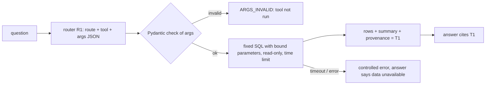
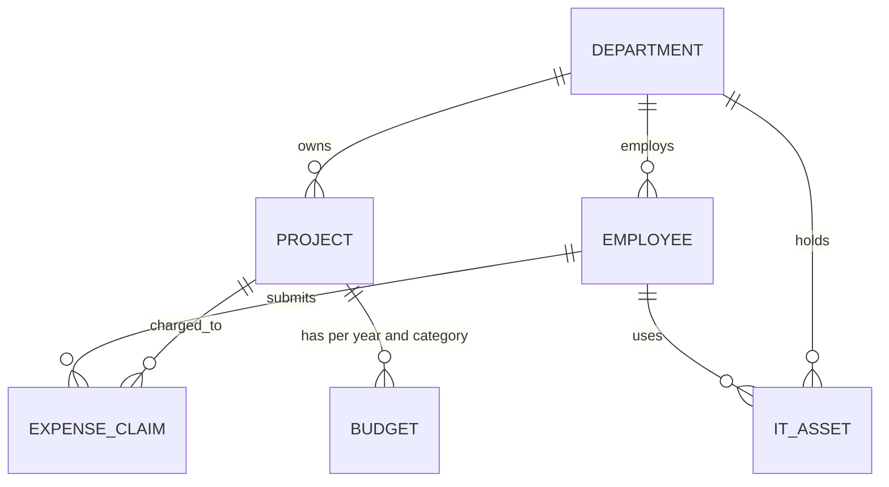

<!-- Contract 13. Owner: Sinngam (P3). Status: DRAFT until the design review, then FROZEN v1.0.
     After freezing, change only through the design-change skill: an entry in CHANGES.md and a version bump. -->
# 13 SQL data and approved tools

Version: 1.0 · Status: DRAFT · Owner: Sinngam (P3); routing to the tools is Arka's (contract 04) · Case section(s): 3, 4.1 ("SQL or approved API tool calling against a
provided synthetic business dataset"), 5 FR-07, 6 (Tools layer), 9 (structured, combined, tool-failure scenarios)

## 1. The idea

The model never writes SQL. It picks one **approved tool** from a registry and fills its arguments. Code checks the
arguments, runs fixed SQL on a **read-only** connection, does all arithmetic in SQL, and returns the rows with their
provenance. The answer cites the tool result like a document (`T1`).



## 2. Where the data comes from

| Case | What we do |
|---|---|
| No dataset is provided (our assumption 1) | `scripts/make_business_data.py` builds `business.db` from `evals/facts.md` with a fixed seed. Anchor facts (for example P-104) are written exactly; the rest is random but repeatable. |
| The organisers provide a dataset (CSV, Excel or a database) | `scripts/load_business_data.py` loads it into the same SQLite file, one table per file, with types and keys checked. Then we write approved tools for its tables. The registry design does not change. |

## 3. Schema (`business.db`, SQLite; tested)

A fictional company. No personal data: people are codes such as `E1042`, never names, phones or emails.



| Table | Columns (key first) | Why it exists (which document it pairs with) |
|---|---|---|
| `department` | `dept_id` (`D-ENG`), `name`, `cost_centre` | groups everything |
| `employee` | `employee_code` (`E1042`), `dept_id`, `grade` (G1 to G6), `location`, `join_date`, `status` (ACTIVE, EXITED) | headcount; grade links to policy entitlements |
| `project` | `project_id` (`P-104`), `name`, `dept_id`, `status` (ACTIVE, ON_HOLD, CLOSED), `start_date`, `end_date` | exact-ID questions |
| `budget` | (`project_id`, `fiscal_year` `FY2026-27`, `category`), `amount_paise` | "over budget?" with the travel policy's overrun rule |
| `expense_claim` | `claim_id` (`EXP-20871`), `project_id`, `employee_code`, `category`, `city`, `claim_date`, `fiscal_year`, `amount_paise`, `status` (SUBMITTED, APPROVED, REJECTED, PAID), `policy_version` | spend questions with the travel and expense policy |
| `it_asset` | `asset_id` (`LT-0457`), `asset_type` (LAPTOP, DESKTOP, PHONE), `employee_code`, `dept_id`, `encrypted` (0 or 1), `last_patch_date`, `os` | compliance questions with the IT security SOP (`POL-HR-014`) |

Categories: TRAVEL, MEALS, LODGING, SOFTWARE, HARDWARE, TRAINING. Every status and category column has a CHECK
list; foreign keys are on; indexes on `expense_claim (project_id, fiscal_year, category)`, `(status)` and
`it_asset (dept_id, asset_type)`.

**Money is INTEGER paise.** SQLite has no exact decimal type, and `SUM` over a decimal-looking column returns a
float. Integer paise sum exactly; Python turns them into `Decimal` rupees only for display.

**Fiscal year** is the Indian one, April to March, stored on each claim (`FY2026-27` = 1 Apr 2026 to 31 Mar 2027).

### Business meaning lives in two views, once

| View | Definition | Why |
|---|---|---|
| `v_spend` | claims with status APPROVED or PAID | "spent" must mean the same in every tool; SUBMITTED and REJECTED do not count |
| `v_budget_status` | each budget row with `spent_paise` = sum of `v_spend` for the same project, year and category | one tested place for "over budget" |

Size: 4 departments, about 40 employees, 8 projects, about 300 claims, about 60 assets.

## 4. The approved tools (registry)

One file per tool in `app/tools/`, registered in `app/tools/registry.py`. Each tool has:

| Field | Meaning |
|---|---|
| `name`, `version` | `budget_status`, `1` (the version goes into the provenance) |
| `source` | which connection (`business`) |
| `description` | one sentence the router reads to choose the tool |
| `args` | a Pydantic model: types, allowed values, limits, and "id must exist" checks |
| `sql` | fixed text with named parameters; table and column names never come from the question |
| `max_rows`, `timeout_ms` | 20, 2000 |
| `summary` | a Python function that writes the result in words with the exact numbers |
| `approved_by`, `approved_on`, `test` | who reviewed it, when, and its test name |

| Tool | Arguments | Returns | Example question |
|---|---|---|---|
| `project_info` | `project_id` | project, department, status, dates | "Who owns P-104 and is it active?" |
| `budget_status` | `project_id`, `fiscal_year`, `category?` | budget, spent, remaining, % used, per category | "Is P-104 over its travel budget?" |
| `spend_summary` | `group_by` (project, department, category, city), `fiscal_year?`, `dept_id?`, `project_id?`, `category?` | total spend per group, top 20 | "Travel spend by city this year?" |
| `claims_list` | `project_id?`, `employee_code?`, `status?`, `category?`, `min_amount?`, `order` (newest, largest), `limit` ≤ 20 | claim rows | "Largest pending claims on P-104?" |
| `asset_compliance` | `dept_id?`, `asset_type?`, `max_patch_age_days` (default 30) | per department: assets, not encrypted, patch overdue | "How many Finance laptops are not encrypted?" |
| `headcount` | `dept_id?`, `location?`, `grade?` | counts only, never a list of people | "How many G4 staff in Mumbai?" |

`spend_summary.group_by` is **not** put into the SQL as text. It selects one of 4 fixed SQL strings in the tool file.

Contract 14 adds four more tools to this registry over the financial facts (source `knowledge`, read-only): `metric_value`, `metric_compare`, `metric_trend`, `segment_breakdown`.

Tested SQL of `budget_status` (runs on SQLite):

```sql
SELECT project_id, category, budget_paise, spent_paise,
       budget_paise - spent_paise AS remaining_paise,
       ROUND(100.0 * spent_paise / NULLIF(budget_paise, 0), 1) AS pct_used
FROM v_budget_status
WHERE project_id = :project_id AND fiscal_year = :fiscal_year
  AND (:category IS NULL OR category = :category)
ORDER BY category
```

With the facts sheet data it returns budget ₹4,00,000, spent ₹4,35,500, remaining −₹35,500, 108.9 % used.

## 5. How a call runs

1. **Route.** Rule R1 and the planner LLM return `{route, tool, tool_args}` (contract 04). The planner sees each
   tool's `name`, `description` and argument schema, nothing else about the database.
2. **Check.** Pydantic validates `tool_args`. Unknown project or department ids are checked against the database.
   Fail: status `ARGS_INVALID`, the tool does not run, and the answer says which value was not recognised.
3. **Run.** `sqlite3.connect("file:business.db?mode=ro", uri=True)`: the connection cannot write (tested: a
   `DELETE` fails with "attempt to write a readonly database"). Parameters are bound, never pasted into the text.
   A progress handler stops the query after `timeout_ms`; we fetch at most `max_rows`.
4. **Summarise.** Python turns the rows into one sentence with exact numbers, for example "P-104 TRAVEL FY2026-27:
   budget ₹4,00,000, spent ₹4,35,500, over by ₹35,500 (108.9 % used)". **The LLM does no arithmetic.** It quotes
   the numbers, and the grounding check (contract 11) verifies they appear in `T1`.
5. **Record.** `tool_call` row: tool, version, arguments (masked), status, row count, latency.

**Tool statuses and what the user sees**

| Status | Meaning | Answer | Outcome (contract 11) |
|---|---|---|---|
| OK | rows returned | uses them, cites T1 | SUCCESS if the rest passes |
| EMPTY | valid query, 0 rows | "There are no matching claims", cites T1 | SUCCESS (an empty result is an answer) |
| ARGS_INVALID | a value failed the check | says which value was not recognised | PARTIAL `TOOL_FAILED` |
| TIMEOUT, DB_ERROR | the query did not finish | "the data is not available now"; uses documents only if the route was BOTH | PARTIAL `TOOL_FAILED` |
| NO_TOOL | a data question no tool covers | "I cannot answer this from the approved data" | PARTIAL `NO_EVIDENCE` |

## 6. How a data source is connected (admin and developer)

| Who | Can | Cannot |
|---|---|---|
| Developer | add a source (a connection string in the environment, `TOOLS_SOURCE_<NAME>_URL`, with a read-only user); add a tool file with SQL, arguments, a summary and a test | add a tool without review and a test |
| KNOWLEDGE_ADMIN | see sources and approved tools (`GET /tools`), run a tool with sample arguments (`POST /tools/{name}/try`), see each tool's success rate on the dashboard | connect a database or write SQL from the screen |
| The model | choose a tool and fill its arguments | write SQL, see table names, call a tool not in the registry |

Moving to PostgreSQL: the connection string changes to a role that has only `SELECT` on the two views and the
tables the tools use, plus `statement_timeout`. The tool files do not change, because they use standard SQL with
named parameters. The case puts real-time connectors to many enterprise platforms out of scope (4.2), so we do not
build a connection wizard.

## 7. MAY: guarded free-form query (off by default)

Only if time remains, behind the flag `tools.freeform_sql`: the LLM writes one `SELECT` over the two views only; a
SQL parser (sqlglot) refuses anything that is not a single SELECT on allowed views and columns; we add `LIMIT 20`;
it runs read-only with the same time limit; the answer is labelled "computed by a generated query", and its
outcome is never higher than PARTIAL. We measure it separately on the test set.

## 8. Tests (written before the tool code; Arka reviews them)

| Test | Expected |
|---|---|
| `test_budget_status_p104` | budget 40000000, spent 43550000 paise, 108.9 % (facts sheet) |
| `test_spend_counts_approved_and_paid_only` | SUBMITTED and REJECTED claims are not in `v_spend` |
| `test_readonly_connection` | a write raises "attempt to write a readonly database" |
| `test_unknown_project_args_invalid` | `P-999` gives ARGS_INVALID, no SQL run |
| `test_group_by_not_injectable` | `group_by="city; DROP TABLE x"` fails validation |
| `test_empty_result_is_success` | a project with no claims gives EMPTY and a sentence, not an error |
| `test_timeout_controlled` | a slow query stub gives TIMEOUT and a PARTIAL answer |
| `test_headcount_never_lists_people` | the result has counts only |
| `test_route_both_for_policy_and_project` | "what does the policy say about P-104's overspend?" gives route BOTH |

## 9. Combined questions for the demo and the test set

| Question | Route | Tool | Document |
|---|---|---|---|
| Is P-104 over its travel budget, and who must approve the overrun? | BOTH | `budget_status` | travel policy v2.0, overruns section |
| How many Finance laptops are not encrypted, and what does POL-HR-014 require? | BOTH | `asset_compliance` | IT security SOP |
| Which P-104 claims are still pending, and how long does approval take under the policy? | BOTH | `claims_list` | travel policy v2.0, approval SLA |
| Average claim per employee by grade? | none fits | NO_TOOL | none, so "cannot answer from the approved data" |

Limit we state: a question where the tool needs a number from a document first ("claims above the policy's Mumbai
per diem") needs two steps in order. Our graph runs the document search and the tool side by side, so the user must
give the number, or the answer gives the policy value and suggests the follow-up.
