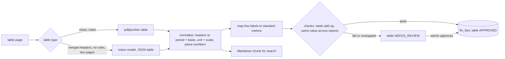

<!-- Contract 14. Owners: Myank (P1) extraction and checks, Sinngam (P3) tools. Status: DRAFT until the design review, then FROZEN v1.0.
     After freezing, change only through the design-change skill: an entry in CHANGES.md and a version bump. -->
# 14 Financial reports and their tables

Version: 1.1 · Status: DRAFT · Owners: Myank (P1) extraction and checks, Sinngam (P3) tools, Arka (P2) routing and eval cases · Case section(s): 3, 4.1, 5
(FR-02, FR-07, FR-09), 9 (structured, combined, conflicting scenarios)

## 1. The idea

Every financial table is stored **twice**:

| Copy | Where | Used for |
|---|---|---|
| Markdown table chunk (contract 10, X4 and X8) | vector and BM25 index | search, citation, questions about the text around a table |
| Normalised rows, one per number | `fin_fact` table in `knowledge.db` | exact numbers, comparisons, totals and trends through approved tools |

The model never reads numbers out of several table chunks and never does the maths. Questions with numbers go to
the facts tools; "why" questions (management discussion) go to text search; a question that needs both takes route
BOTH, with one citation for the number and one for the reason.

## 2. Extraction steps (Myank)

| Step | Rule | Why |
|---|---|---|
| F1 Find | pdfplumber `find_tables()`, and the Markdown tables of OCR pages; a numeric page (TABLE_HEAVY, `num_ratio` ≥ 0.30) where pdfplumber finds no ruled table goes to the vision model, which returns JSON `{caption, unit_line, header_rows[], rows[][]}`. Merged header cells are filled from the left; a continuation is joined by F2. A table read by a vision model always goes to review (gap G7) | pdfplumber misses tables without lines; annual reports often have them |
| F2 Continuation | a table whose next page starts with the same header row, or with no header and the same column count, is joined; `pages` records both | long notes and segment tables cross pages |
| F3 Headers to dimensions | each value column gets `period` (from "Year ended 31 March 2025" = FY2024-25; "Q2 FY25" = FY2024-25 Q2) and `basis` (CONSOLIDATED or STANDALONE, from the table title or the section heading). A column marked "Note" is dropped | standalone and consolidated figures must never mix |
| F4 Unit and scale | from the caption or the line above: "₹ in crore" = INR × 1,00,00,000; "₹ in lakh" × 1,00,000; "in million" × 10,00,000; "%" = PERCENT; per-table, stored on `fin_table` | a crore against a million mix-up is a 10× error |
| F5 Parse numbers | `(1,234.50)` = −1,234.50; `1,23,456` = Indian grouping; `-`, a long dash, `nil` = 0; values kept as integers in the base unit (rupees; percent in basis points; per-share amounts such as EPS in paise, `value_kind` PER_SHARE, because ₹45.67 is not a whole number of rupees) and also **as printed** | exact sums, and the citation shows what the page says |
| F6 Map labels | the line label goes through a dictionary of standard metrics (section 4). An unknown label gets an LLM-proposed mapping that waits for approval; until then its `metric` is empty and no tool uses it | "Revenue from operations" and "Total income from operations" must mean the same metric only when a person agrees |
| F7 Checks | (a) at every "Total ..." row, the shortest run of rows or subtotals just above it adds up to it within 1 unit of its printed precision (so "Total assets" is checked against the two subtotals); a total with no rows of its own above it (after a sub-heading, a total or a "Profit ..." line) is recorded as unverified, not failed; (b) a metric and period already stored from another report has the same value, or is marked restated (section 5). Also NEEDS_REVIEW: basis or unit not found, a number that does not parse (`1,23,4S6`), an unmapped label, a table read by a vision model | catches misread digits and wrong columns |
| F8 Review | NEEDS_REVIEW tables appear on the admin page beside the page image (same gate as contract 10 X7); approve or reject | a person signs off numbers the checks could not confirm |

Tested: number parsing (`(1,234.50)` × crore = −12,34,50,00,000 rupees; `1,23,456`; `-` = 0) runs exactly with `Decimal`.

## 3. Schema (in `knowledge.db`; tested in SQLite)

| Table | Columns |
|---|---|
| `report` | `report_id` (`R-CA-25`: company initials and fiscal year), `company`, `report_type` (ANNUAL, QUARTERLY), `fiscal_year`, `published_on` (the document's effective date), `document_id` |
| `fin_table` | `table_id`, `report_id`, `pages`, `statement` (PL, BS, CF, SEGMENT, OTHER), `basis`, `currency`, `scale` (1, 1,000, 1,00,000, 10,00,000, 1,00,00,000), `unit_printed`, `caption`, `source` (text, ocr, vision), `rows_json` (the table as read, for the review screen), `checks_passed`, `checks_json` (each check and why it failed), `status` (NEEDS_REVIEW, APPROVED, REJECTED), `reviewed_by`, `reviewed_at`, `review_comment` |
| `fin_fact` | `fact_id`, `table_id`, `report_id`, `company`, `period`, `basis`, `metric` (empty until mapped), `segment`, `line_label` as printed, `label_norm` (normalised, the key of `metric_map`), `value_kind` (AMOUNT, PERCENT, COUNT, PER_SHARE), `value_num` (integer, base unit), `value_printed`, `page`, `row_no` (line item number in the table), `col_no` |
| `metric_map` | `line_label` (normalised), `metric`, `proposed_by` (DICTIONARY, LLM, ADMIN), `approved_by` (NULL = waiting), `approved_on` |

**Which documents give facts.** A document uploaded with the optional field `company` (and optionally `report_type`,
default ANNUAL, and `fiscal_year` like FY2024-25, default the fiscal year before the effective date). Other documents
give chunks only.

Index on `fin_fact (company, metric, period, basis)`.

**View `v_fact_current`** (tested): only APPROVED tables and mapped metrics; for each company, metric, period, basis
and segment the **newest report wins** (`ROW_NUMBER` by `published_on`), and `restated = 1` when two reports give
different values for the same item; then `prev_value_num`, `prev_value_printed`, `prev_report_id` and `prev_page`
give the older value for the "was ..." text and its citation.

## 4. Standard metrics (start list; extend with approval)

| Metric | Usual labels | Kind |
|---|---|---|
| `revenue` | Revenue from operations; Total revenue from operations | AMOUNT |
| `other_income` | Other income | AMOUNT |
| `total_income` | Total income | AMOUNT |
| `employee_cost` | Employee benefits expense | AMOUNT |
| `ebitda` | EBITDA; Earnings before interest, tax, depreciation and amortisation | AMOUNT |
| `depreciation` | Depreciation and amortisation expense | AMOUNT |
| `finance_cost` | Finance costs | AMOUNT |
| `pbt` | Profit before tax | AMOUNT |
| `tax` | Total tax expense | AMOUNT |
| `pat` | Profit for the year; Net profit | AMOUNT |
| `eps_basic` | Basic EPS (₹) | AMOUNT (per share, scale 1) |
| `total_assets`, `total_equity`, `borrowings`, `cash` | balance sheet totals | AMOUNT |
| `operating_cash_flow` | Net cash from operating activities | AMOUNT |
| `operating_margin` | Operating margin (%) when printed | PERCENT |
| `headcount` | Number of employees | COUNT |
| `segment_revenue` | revenue rows of the segment table, with `segment` set | AMOUNT |

A ratio we can compute (margin = EBIT ÷ revenue) is computed by the tool from two approved facts and labelled
"computed", never taken from the model.

## 5. Several reports with the same number

The FY2023-24 revenue appears in the FY2023-24 report and again as the comparison column of the FY2024-25 report.
We keep both rows. The tools use the newest report's value; if the values differ, the answer says "restated in the
FY2024-25 report (was ₹10,000 crore)" and cites both pages. This is conflict rule C1 (contract 04) for numbers.

## 6. Approved tools (Sinngam; added to the registry of contract 13, source `knowledge`, read-only)

| Tool | Arguments | Returns | Example |
|---|---|---|---|
| `metric_value` | `company`, `metric`, `period`, `basis` = CONSOLIDATED, `segment?` | value, printed value, unit, report, page, restated flag | "Company A revenue in FY2024-25?" |
| `metric_compare` | `metric`, `basis`, and either `company` + `periods[]` or `companies[]` + `period` | values side by side, change and growth %, restated flags | "Revenue FY2025 vs FY2024 and growth?" |
| `metric_trend` | `company`, `metric`, `from_period`, `to_period`, `basis` | one value per period, year-on-year growth | "Profit over the last 5 years?" |
| `segment_breakdown` | `company`, `period`, `metric` = segment_revenue | value and share of total per segment | "Revenue by segment in FY2024-25?" |

Rules for all four:

1. Compare only facts with the same `basis` and `value_kind`; amounts are already in base units, so scales never mix.
2. Missing metric or period: status EMPTY and the answer "not found in the reports"; never an estimate.
3. Growth and shares are computed in SQL (tested: `metric_compare` gives 12.0 % for ₹10,050 to ₹11,256 crore).
4. Each number is cited as report, page, table, row: `T1 · Company A FY2024-25 report · p.52 · P&L row 3`.

## 7. Routing (adds to contract 04 R1)

| Question shape | Route | Example |
|---|---|---|
| a metric word + a period or company, or "compare", "growth", "trend", "by segment" | SQL (facts tools) | "Compare revenue FY24 and FY25" |
| "why", "reason", "explain", "outlook", "risk" about a report | DOCS | "Why did margins fall?" |
| both in one question | BOTH | "How much did profit grow and why?" |

## 8. Tests and evaluation (Myank and Sinngam for unit tests, Arka for eval cases)

| Test or case | Expected |
|---|---|
| `test_parse_brackets_negative` | `(1,234.50)` in crore = −12,345,000,000 rupees |
| `test_crore_vs_million_not_mixed` | a crore table and a million table give the same base-unit value for the same amount |
| `test_standalone_not_in_consolidated` | `metric_compare` with CONSOLIDATED never returns the standalone row |
| `test_newest_report_wins_and_restated` | FY2023-24 revenue = 10,050 from the newer report, `restated = 1` |
| `test_growth_in_sql` | 12.0 % for 10,050 to 11,256 |
| `test_totals_check_flags_review` | a misread component makes the total check fail; table NEEDS_REVIEW |
| `test_unmapped_label_not_used` | a label without an approved mapping is never returned by a tool |
| `test_missing_period_not_found` | asking for FY2019-20 gives EMPTY and "not found in the reports" |
| gold tables (contract 10 section 10) | 3 to 4 hand-typed tables: one multi-level header, one across two pages, one with brackets; table cell accuracy and numeric recall |
| eval cases (contract 11) | cross-report comparison, restated figure, crore against million, a metric not in the reports, "how much and why" (BOTH) |

## 9. Scope and cost

About one extra iteration for Myank (WP-EX6) and half an iteration for Sinngam (WP-BE3). If time is short: build the facts for P&L and segment tables only; other tables
stay Markdown chunks, which still give cited answers through search.
